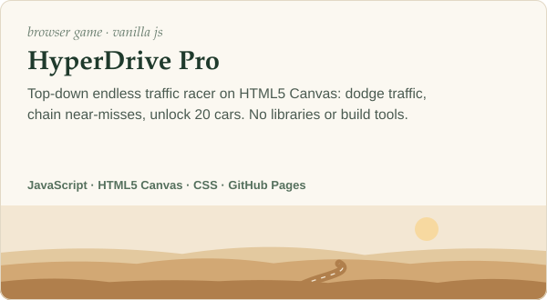
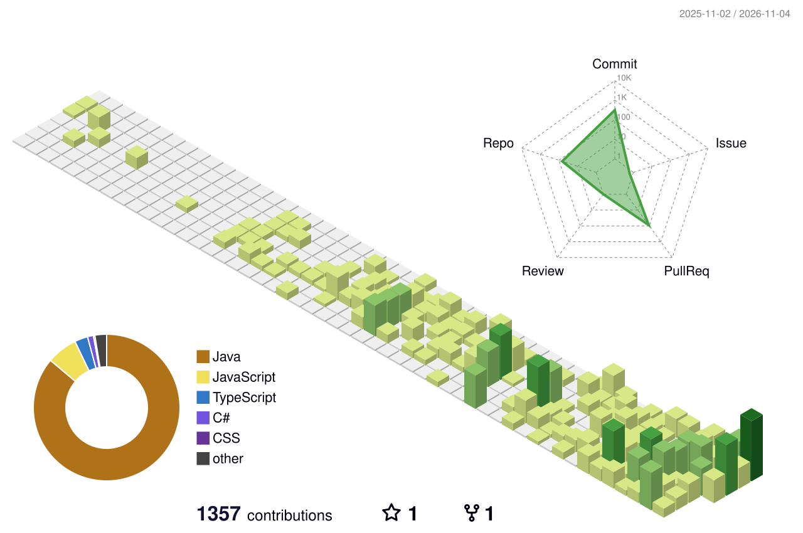

  

  
  
  

## About

I'm Mikayil, a software engineer and Computer Engineering student at Baku Engineering University. Most of what I build is in **Java and Spring Boot**: REST APIs, JWT-based security, and a microservice platform behind a Spring Cloud Gateway. I also did the **Ironhack** bootcamp, where I worked with React and Next.js on the frontend side.

## Tools I use

<table align="center">
  <tr>
    <td align="right">Backend</td>
    <td></td>
  </tr>
  <tr>
    <td align="right">Data</td>
    <td></td>
  </tr>
  <tr>
    <td align="right">DevOps &amp; cloud</td>
    <td></td>
  </tr>
  <tr>
    <td align="right">Frontend</td>
    <td></td>
  </tr>
  <tr>
    <td align="right">Other</td>
    <td></td>
  </tr>
</table>

## Projects

<table>
  <tr>
    <td width="50%"></td>
    <td width="50%"></td>
  </tr>
  <tr>
    <td width="50%"></td>
    <td width="50%"></td>
  </tr>
</table>

Also: [Aztudy frontend](https://github.com/miko44quliyev/Aztudy-frontend) (React + Vite) · [account-service](https://github.com/miko44quliyev/account-service) (Spring Boot 4) · [play HyperDrive in the browser](https://miko44quliyev.github.io/mini-car-game/)

## Activity

  <picture>
    <source media="(prefers-color-scheme: dark)" srcset="./profile-3d-contrib/profile-night-green.svg" />
    
  </picture>

  <picture>
    <source media="(prefers-color-scheme: dark)" srcset="https://streak-stats.demolab.com/?user=miko44quliyev&hide_border=true&background=17251C&ring=8FBF8F&fire=D9A15B&currStreakNum=EDE6D6&sideNums=EDE6D6&currStreakLabel=A7C4A0&sideLabels=A7BFAE&dates=7A8F7F&stroke=2E4536" />
    
  </picture>

  <picture>
    <source media="(prefers-color-scheme: dark)" srcset="./dist/github-contribution-grid-snake-dark.svg" />
    
  </picture>

  

