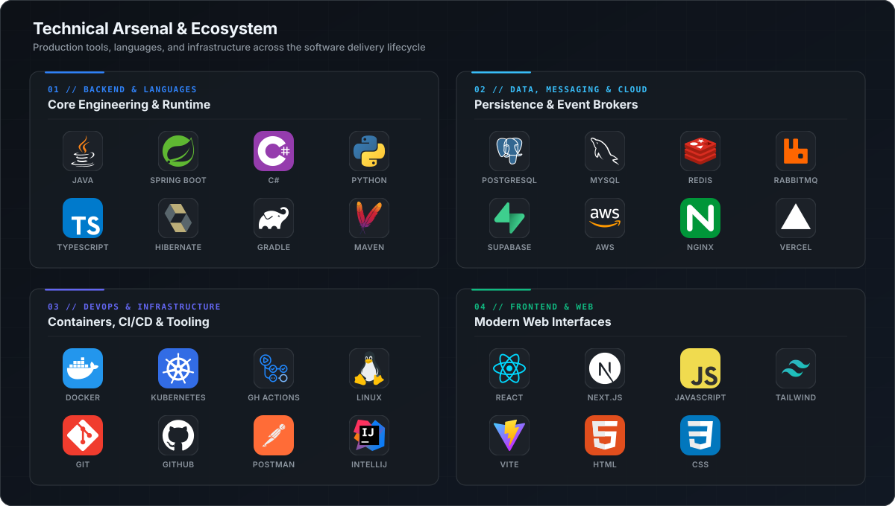
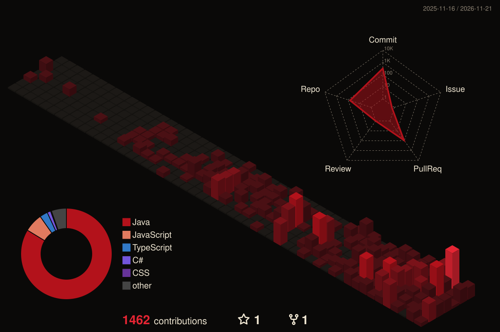

  

  
  
  

## About

I'm **Mikayil Guliyev**, a Software Engineer focused on designing and building scalable, production-ready distributed systems, backend architectures, and high-performance microservices. My technical foundation centers on clean architecture, asynchronous event-driven pipelines with RabbitMQ, relational data modeling and query optimization in PostgreSQL, and robust API security using Spring Security and JWT. Experienced across multiple languages and modern frameworks including Kotlin, Java, C#, TypeScript, and cloud-native tooling, currently pursuing a B.Sc. in Computer Engineering at Baku Engineering University (GPA: 92.8/100), an Ironhack Web Development & AI graduate (100/100), and an ICPC Programming Tournament quarter-finalist.

## Tech Stack

  

## Activity

  

  

  

