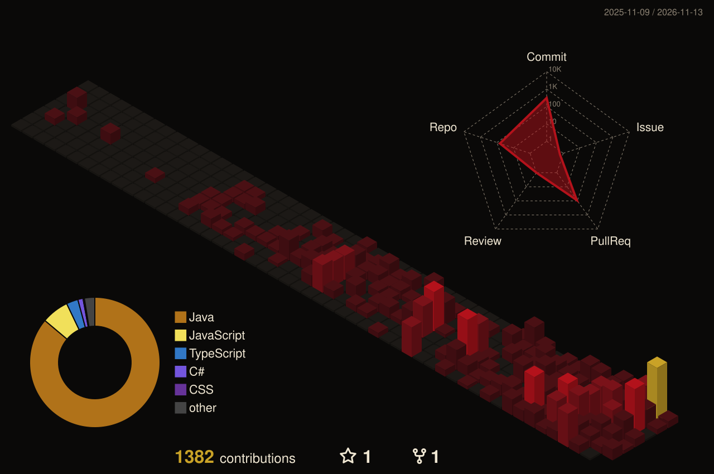

  

  
  
  

## About

I'm Mikayil, a software engineer and Computer Engineering student at Baku Engineering University. Most of what I build is in **Java and Spring Boot**: REST APIs, JWT-based security, and a microservice platform behind a Spring Cloud Gateway. I also did the **Ironhack** bootcamp, where I worked with React and Next.js on the frontend side.

## Tools I use

  

## Activity

  

  

  <picture>
    <source media="(prefers-color-scheme: dark)" srcset="./dist/github-contribution-grid-snake-dark.svg" />
    
  </picture>

  

